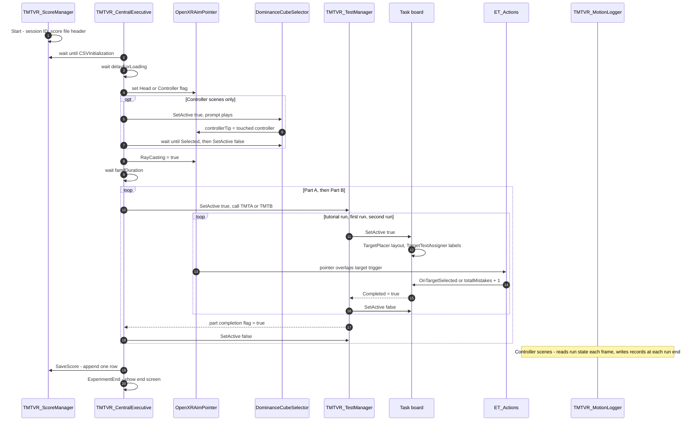
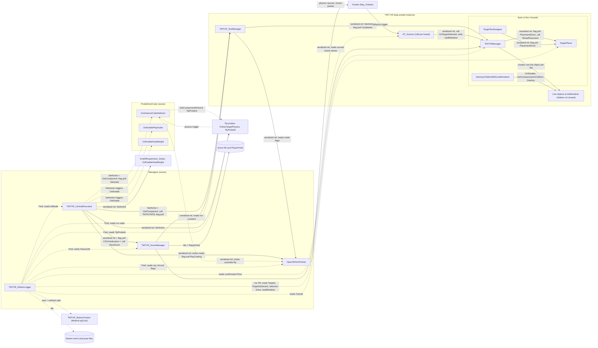

# TMT-VR architecture

TMT-VR is a virtual-reality version of the Trail Making Test (TMT), a neuropsychological test with two parts. In Part A the participant connects numbered targets in ascending order (1, 2, 3 ...). In Part B the participant alternates between numbers and letters in ascending order (1, A, 2, B ...). In TMT-VR the participant connects the targets by pointing at each one in turn, with the head or with a controller, and holding the pointer on it until the selection is confirmed.

This document explains how the TMT-VR Unity project is put together. It is written for a reader who is new to the code. It covers the session flow, interaction, language, the links between scripts, the scene layout, data outputs, legacy code, extension points and known caveats.

Related documents:
- [SCRIPTS.md](SCRIPTS.md): one section per script.
- [VARIANTS.md](VARIANTS.md): the four builds and the settings that differ between them.
- [DATA_OUTPUTS.md](DATA_OUTPUTS.md): the files the apps write.

Statements marked *(inferred)* come from reading the code and the serialized scene data. They were not observed at runtime. The terms used across the documents are defined in the [glossary](#glossary).

## Contents

1. [Project at a glance](#1-project-at-a-glance)
2. [Session flow](#2-session-flow)
3. [Interaction: from head or controller to a selected target](#3-interaction-from-head-or-controller-to-a-selected-target)
4. [Language selection](#4-language-selection)
5. [How the scripts communicate](#5-how-the-scripts-communicate)
6. [Scene hierarchy essentials](#6-scene-hierarchy-essentials)
7. [Data outputs](#7-data-outputs)
8. [Legacy and inactive paths](#8-legacy-and-inactive-paths)
9. [Extension points](#9-extension-points)
10. [Known caveats](#10-known-caveats)

---

## 1. Project at a glance

- **Engine and platform.** Unity 6000.2.10f1 and OpenXR, built for the VIVE Focus Vision in two forms: Android standalone apps (APKs) and Windows 64-bit PC VR apps. The project uses `com.unity.xr.openxr`, `com.unity.xr.androidxr-openxr` and the XR Interaction Toolkit (`com.unity.xr.interaction.toolkit`).
- **One project, four scenes, eight builds.** Each scene is built into its own APK and its own PC VR build:

| Scene | Interaction | Language | Motion logging |
|---|---|---|---|
| `Assets/TMTVR_Head_EN.unity` | Head | English | off |
| `Assets/TMTVR_Head_GR.unity` | Head | Greek | off |
| `Assets/TMTVR_Controller_EN.unity` | Controller | English | on |
| `Assets/TMTVR_Controller_GR.unity` | Controller | Greek | on |

- **Same objects, different settings.** The four scenes contain the same objects and scripts. They differ only in serialized settings: the interaction mode, the motion-log switch, a set of language settings, and the placement and font of the English end-screen panel. [VARIANTS.md](VARIANTS.md) lists them.
- **Two platforms.** An APK runs on the headset itself. A PC VR build runs on a Windows PC, with the headset connected through an OpenXR runtime. Both builds of a scene use the same scene, scripts and settings; only the target platform and the version label differ. No TMT-VR runtime script contains platform-specific code. In these documents, "the four builds" means the four apps on either platform.
- **Custom code.** All TMT-VR scripts are in `Assets/TMT-VR For Export/` (the motion logger is in its `MotionLog/` subfolder). The Editor tools are `Assets/Editor/TMTVRReleaseBuild.cs` (Android), `Assets/Editor/TMTVRReleaseBuildPCVR.cs` (Windows PC VR) and `Assets/Editor/ET_ActionsEditor.cs`.
- **One task prefab.** Most of the task lives in `Assets/TMT-VR For Export/TMT-VR_Greek.prefab`. Each scene holds one instance of it, renamed `TMT-VR` and inactive at load. The prefab name is historical: the same prefab serves the English and the Greek scenes. Many of its current values, including all instruction audio clips, are stored as scene-level prefab overrides, not in the prefab itself.
- **Coordination style.** The scripts do not use C# events between them, `SendMessage` or UnityEvents. They coordinate in three ways:
  1. a serialized reference to another component, set in the Inspector;
  2. switching a GameObject on or off, which runs that object's `OnEnable` or `OnDisable`;
  3. a coroutine that waits (`WaitUntil`) for a public `bool` flag on another component.

### Glossary

- **Part.** Part A (numbers only) or Part B (numbers and letters alternating).
- **Board.** One GameObject that holds a set of candidate targets and the scripts that run the task on them (`TargetPlacer`, `TargetTextAssigner`, `TMTVRManager`, `DestroyChildrenWithLineRenderer`). There are four boards: `TMT-VR_Part_A_Tutorial`, `TMT-VR_Part_A`, `TMT-VR_Part_B_Tutorial` and `TMT-VR_Part_B`. The two boards without "Tutorial" in their name are the **scored boards**.
- **Run.** One activation of a board, from switching it on to its completion. Each part has three runs: a **tutorial run** on the tutorial board (8 targets), then a **practice run** and a **scored run** on the scored board (25 targets each). Only the scored run is written to the score file. The motion log calls the three stages `tutorial`, `practice` and `test`.
- **Target.** One selectable item on a board. Each board has 168 targets: a fixed first target, `TargetLarge (141)`, and 167 candidates under `Line1` to `Line6`, from which 7 or 24 are chosen anew at each run (8 or 25 targets in all).
- **Selection.** A correct confirmation of the target that is next in order. An **error** is a confirmation on any other target that is not already selected.
- **Link.** The interval between two consecutive correct selections. A run of 25 targets has 24 links.
- **Dwell.** The time the pointer must stay on a target before the target is evaluated (`ET_Actions.confirmationTime`, 0.5 s in this release). The spoken instructions and on-screen labels tell participants to hold for one second.
- **Probe.** A small physics object that follows a controller tip or a fingertip. The controller probes are used only to choose the pointing controller at the start of the Controller scenes.
- **Episode.** In the motion log, one continuous stretch of rendered frames in which the ray hits one target.

---

## 2. Session flow

### 2.1 Ordered steps

The session runs as one coroutine, `TMTVR_CentralExecutive.ExecuteTasks()`, started from `Start`. The steps below are in order.

1. **Session ID and score file.** `TMTVR_ScoreManager.Start` reads and increments the session counter in PlayerPrefs, creates the score file `scoresID<SessionID>.csv` with its header row, and sets `CSVInitialization = true`.
2. **Wait for the score file.** `TMTVR_CentralExecutive` waits until `CSVInitialization` is true, then waits `delayForLoading` (1 s).
3. **Pointer check.** If `aimPointer` is not set, `TMTVR_CentralExecutive` logs an error and stops. Nothing after this step runs.
4. **Interaction mode.** `TMTVR_CentralExecutive` reads its serialized `intMode`. It sets one flag on `OpenXRAimPointer` (`Head` or `Controller`) and switches the matching rig objects on and the others off.
5. **Dominant controller (Controller scenes only).** `TMTVR_CentralExecutive.DominanceCheck()` switches `ProbeDomiCube` on. `OnEnableHeadHeight` places the cube 0.2 m below head height, and `OnEnablePlayAudio` plays the dominant-hand prompt after 1 s. The participant touches the cube with one controller. `DominanceCubeSelector` sets `OpenXRAimPointer.controllerTip` to that controller's tip and sets `Selected`. The executive waits for `Selected`, with no timeout, and switches the cube off. The Head scenes skip this step.
6. **Probes off and ray on.** `DisableTips()` switches off the four tip probes. The executive then sets `OpenXRAimPointer.RayCasting = true`, and the pointer appears.
7. **Familiarisation.** The executive waits `familDuration` (3 s).
8. **Part A.** The executive switches `TMT-VR` on, gets its `TMTVR_TestManager`, calls `TMTA()` and waits for `TMT_PartAcompleted`. `TMTVR_TestManager.TMT_PartA()` then runs these stages:
   1. general instructions (audio);
   2. the mode-specific tutorial instructions (audio): the Head clip in Head scenes, the Pointer clip in Controller scenes;
   3. a tutorial run on `TMT-VR_Part_A_Tutorial` (8 targets);
   4. a first run on `TMT-VR_Part_A` (25 targets), introduced by the practice clip and shown with the practice instruction panel, followed by the confirmation sound;
   5. a second run on `TMT-VR_Part_A`, introduced by the start clip, followed by the confirmation sound;
   6. `TMT_PartAcompleted = true`.

   The executive then switches `TMT-VR` off.
9. **Part B.** The same as Part A with the Part B boards and clips, without the general instructions.
10. **Inside each run.** Enabling a board runs `TargetPlacer` (new layout), `TargetTextAssigner` (labels) and `TMTVRManager` (run state). The participant points; `OpenXRAimPointer` moves the pointer; `ET_Actions` on each target confirms a selection after the dwell or counts an error. `TMTVRManager` sets `Completed` after 8 correct selections (tutorial) or 25 (scored board). Section 3 gives the detail.
11. **Save.** The executive yields on `TMTVR_ScoreManager.SaveScore()`. It reads the Part A and Part B scored-board managers and appends one row to the score file.
12. **End screen.** `ExperimentEnd()` switches `EndOfExperiment_Greek` on. `OnEnableHeadHeight` moves it to head height. The panel shown depends on the scene language (section 4).

**Which run is scored.** Both runs on a scored board use the same `TMTVRManager`, and its `OnEnable` resets the run state. `TMTVR_ScoreManager` therefore reads the values of the second run only.

**Motion log (Controller scenes only).** `TMTVR_MotionLogger` runs alongside steps 8 and 9. It reads the run state, the ray and the head pose every frame, and writes its records when each run ends. It changes nothing in the task. In the Head scenes it switches itself off in `Start`.

### 2.2 Sequence diagram

---

## 3. Interaction: from head or controller to a selected target

### 3.1 How the interaction mode is chosen

There is one switch: the serialized enum `TMTVR_CentralExecutive.intMode` (`eye` = 0, `hand` = 1, `head` = 2, `controller` = 3). It is saved in each scene: 2 in the Head scenes and 3 in the Controller scenes. Nothing at runtime changes it.

At step 4 of the session, `TMTVR_CentralExecutive` turns `intMode` into:
- one boolean on `OpenXRAimPointer`: `Head` or `Controller`;
- the informational string `aimSource` on `OpenXRAimPointer`, which no script reads for behaviour;
- `SetActive` calls on the rig roots (`ControllersInteractionRoot`, `HandsInteractionRoot`, `GazeInteractionRoot`) and on the four tip probes.

| Build | `intMode` | Ray origin and direction | Dominance cube | Rig switched on |
|---|---|---|---|---|
| Head | 2 | Main Camera position and forward direction | Skipped | None |
| Controller | 3 | The touched controller's tip (`TriggerLeft` or `TriggerRight`), along its local axis (0, 0, -1) | Shown | `ControllersInteractionRoot` and the two controller-tip probes until the touch |

Other scripts read the mode from the `OpenXRAimPointer` flags, not from `intMode`. `TMTVR_TestManager` uses the flags to choose the tutorial instruction clip. `TMTVR_MotionLogger` reads `intMode` and the flags, in the Controller scenes only.

### 3.2 Choosing the pointing controller (Controller scenes)

1. Each controller has a probe (`ControlllerTip_L`, `ControlllerTip_R`) with a kinematic `Rigidbody` and a sphere collider. `FollowTargetPhysics` moves it to the controller's tip point each physics step. `TipProbeId` tags it with its side and tracked point.
2. `ProbeDomiCube` has a trigger `BoxCollider`. When a probe enters it, `DominanceCubeSelector.OnTriggerEnter` reads the probe's `TipProbeId` and sets `OpenXRAimPointer.controllerTip` to the probe's tracked point.
3. The ray then follows the tracked point, not the probe. The probes are switched off after the touch.

`OpenXRAimPointer.controllerTip` is empty in the saved scenes. The cube touch is the only way it is set.

### 3.3 Ray, pointer, dwell and confirmation

1. **Ray.** Every frame, `OpenXRAimPointer.LateUpdate` computes the ray origin and direction from the active flag. It casts one `Physics.Raycast` (maximum 20 m) against the layers Default, TransparentFX, Water and UI, with trigger colliders included.
2. **Hit rule.** The cast returns only the nearest collider. The hit counts only if that collider is tagged `ET`. Every target collider (`Target_Collider`) is a trigger `BoxCollider` tagged `ET`. In the prefab the target colliders are on the UI layer; in the scenes, scene-level prefab overrides put them, and their children, on the Default layer. Both layers are in the ray's layer mask, so the ray reaches the targets either way. If the nearest collider is not tagged `ET`, the pointer floats 1 m along the ray and no target is reported.
3. **Pointer.** `OpenXRAimPointer` moves the scene object `Pointer` (an instance of `Ray_Pointer.prefab`) to the hit point. The pointer is tagged `ET_Pointer`, sits on layer 2 (Ignore Raycast, which the ray skips), and has a sphere collider of about 0.05 m radius and a kinematic `Rigidbody`.
4. **Overlap.** Placed at the hit point, the pointer's collider overlaps the target's trigger. Unity then calls `OnTriggerEnter`, `OnTriggerStay` and `OnTriggerExit` on that target's `ET_Actions`.
5. **Dwell.** `ET_Actions` ignores targets that are already selected. On entry it starts a flicker of the target's `Selection` child. On each physics step of the overlap it records the distance between the pointer centre and the target centre. When the overlap has lasted `confirmationTime` (0.5 s in this release, set on every `ET_Actions` in the prefab), it evaluates the target once. The instructions ask participants to hold for one second; the selection is confirmed after the configured 0.5 s.
6. **Correct target** (the target equals `TMTVRManager.CurrentTarget`): plays the confirmation sound, shows the `Selection` child, writes the mean pointer-to-target distance of this entry to `TMTVRManager.accuracy`, and calls `TMTVRManager.OnTargetSelected()`.
7. **Wrong target:** turns the target red, plays the error sound and adds 1 to `TMTVRManager.totalMistakes`. Each entry into a wrong target counts at most once. Leaving and re-entering counts again.
8. **Exit.** Leaving the trigger resets the dwell timer, stops the flicker and restores the colour.
9. **Progress.** `TMTVRManager.OnTargetSelected()` starts the clock at the first correct selection. For each later one it records the link time and the spatial value, draws a line from the previous target, and advances `CurrentTarget`. At 8 (tutorial) or 25 (scored board) correct selections it deactivates the targets and sets `Completed = true`. On a scored board it also computes `totalSelectionTime`, `AverageSelectionTime` and `AverageAccuracy`.

`AverageAccuracy` is a spatial value in Unity world units (metres): the mean, over the 24 links, of the mean pointer-to-target distance during each confirming dwell. Lower means closer. It is a raw descriptive value, not a proportion and not a validated accuracy measure.

### 3.4 Target layout

`TargetPlacer` builds a new layout each time a board is enabled. It starts from a fixed first target and picks each next target from six groups of candidate positions (`Line1` to `Line6`), so that the distance from the previous target falls in one of six 1 m bands between 1 and 6.99 m. A tutorial board has 8 targets and a scored board 25. The two runs on a scored board therefore use two different layouts. `TargetTextAssigner` then labels the targets: numbers for Part A, and alternating numbers and letters for Part B.

---

## 4. Language selection

There is no single global language switch. Each language-dependent element has its own serialized setting, and all of them must agree within a scene.

| Setting | Kind | Controls |
|---|---|---|
| `TMTVR_TestManager.isEnglish` | `bool` (scene-level override on the `TMT-VR` instance) | English or Greek instruction clips (general, tutorial, practice, start) and the English or Greek practice-run panels |
| `TargetTextAssigner.isEnglish` / `isGreek` on the four boards | Two `bool`s; exactly one must be true | Latin or Greek letters on the Part B targets. Equal flags stop all labelling. |
| `OnEnablePlayAudio.language` on `ProbeDomiCube` | Enum `English` = 0, `Greek` = 1 | `DomHand_ENG.mp3` or `DomHand_GR.mp3`; audible only in the Controller scenes |
| Active state of `InstructENG`, `InstructGR`, `InstructENG (1)`, `InstructGR (1)` | `GameObject` active flag, no script | Static instruction overlays on the tutorial boards |
| Active state of `NotesR` and `NotesR_Greek` under `EndOfExperiment_Greek` | `GameObject` active flag, no script | English or Greek end-screen panel |

All the English and Greek audio clips and text objects are present and assigned in every scene. A language variant therefore differs only in the settings above. [VARIANTS.md](VARIANTS.md) gives the exact values, including the placement and font check needed for the English end-screen panel.

Some visible text is the same in both languages:
- the institutional logos and banner textures, which contain English text;
- the XR Interaction Toolkit controller tooltips ("UI Press", "Grab", "Turn", "Move", "Blink"), which sit under `ControllersInteractionRoot` and so can appear only in the Controller scenes.

---

## 5. How the scripts communicate

### 5.1 Mechanisms

| Mechanism | Where it is used |
|---|---|
| **Serialized reference** | The main link type. For example, `TMTVR_CentralExecutive` holds `ScoreManager`, `aimPointer`, `TMT`, `dominanceCube` and the rig roots; each `ET_Actions` holds its board's `TMTVRManager`. |
| **SetActive (OnEnable/OnDisable)** | Starting work on another object. Switching a board on runs `TargetPlacer`, `TargetTextAssigner` and `TMTVRManager`; switching `ProbeDomiCube` on plays the prompt and moves the cube. |
| **Coroutine flag polling** | Waiting for another component: `CSVInitialization`, `Selected`, `TMT_PartAcompleted`, `TMT_PartBcompleted`, `Completed`, `PlacementDone`. |
| **GetComponent / Find** | `TMTVR_CentralExecutive` uses `GetComponent` on `TMT` and on `dominanceCube`. `DominanceCubeSelector` uses `GetComponentInParent<TipProbeId>`. `TMTVR_MotionLogger` finds its sources with `FindFirstObjectByType` and `FindObjectsByType`. |
| **Unity physics** | `OpenXRAimPointer` raycasts against target colliders; the pointer and the probes reach `ET_Actions` and `DominanceCubeSelector` through trigger callbacks. |
| **Static / singleton** | None in use. `TargetPlacer.LayoutPlaced` is a static event with no subscriber. There are no singletons. |
| **UnityEvent** | None between the custom scripts. |
| **File / PlayerPrefs** | `TMTVR_ScoreManager` (score file, session counter) and `TMTVR_MotionLogger` (event and pose files). |

### 5.2 Script-to-script diagram

Solid arrows are active in the release builds. Dotted arrows are active in the Controller scenes only. Legacy and unused links are left out of the diagram and listed in section 8.

---

## 6. Scene hierarchy essentials

The four scenes share this layout. Objects marked "inactive at load" are switched on by code when needed.

| Object | Active at load | Key components | Role |
|---|---|---|---|
| `Managers` | yes | `TMTVR_CentralExecutive`, `TMTVR_ScoreManager`, `OpenXRAimPointer`, `TMTVR_MotionLogger` | Orchestration, scoring, raycasting, motion logging |
| `TMT-VR` (instance of `TMT-VR_Greek.prefab`) | no | `TMTVR_TestManager`, `AudioSource` | Task root; switched on for each part |
| `TMT-VR/TMT-VR_Part_A`, `TMT-VR_Part_B`, `TMT-VR_Part_A_Tutorial`, `TMT-VR_Part_B_Tutorial` | no | `TargetPlacer`, `TargetTextAssigner`, `TMTVRManager`, `DestroyChildrenWithLineRenderer` | One board per run type |
| `.../Line1` to `Line6/TargetLarge (n)/Target_Collider` | no; placed targets are switched on | Trigger `BoxCollider` (tag `ET`; UI layer in the prefab, Default layer through scene overrides), `ET_Actions` | 167 candidate targets per board (the fixed first target `TargetLarge (141)` sits directly under the board) |
| `InstructENG_A`, `InstructGR _A` (under Part A); `InstructENG _B`, `InstructGR _B` (under Part B) | no | Transform only; the text is on child canvases | Practice-run panels, shown by `TMTVR_TestManager` for the scene language |
| `InstructENG`, `InstructGR` (Part A tutorial); `InstructENG (1)`, `InstructGR (1)` (Part B tutorial) | the scene language's pair on | Transform only; the text is on child canvases | Static tutorial overlays; no script references them |
| `Instructions TMT-A`, `Instructions TMT-B` (in the prefab) | no | `TMTVR_InstructionsManager`, `PlayVideoEngGR`, `OnEnableHeadHeight`, `VideoPlayer` | Legacy video path, never switched on |
| `XR Origin Hands (XR Rig)/Camera Offset/Main Camera` | yes | `Camera` | Head pose; head-ray origin |
| `.../ControllersInteractionRoot` | saved on; set by mode | XRI controllers, `TriggerLeft`, `TriggerRight`, tooltips | On in Controller scenes only |
| `.../HandsInteractionRoot` | set by mode | XRI hands, `LeftTipProxy`, `RightTipProxy` | Hand-tracking path; off in all four builds |
| `GazeInteractionRoot/Gaze Interactor` (with `Pointer_ET_Only`) | saved on; switched off at mode set-up | `XRGazeInteractor`, `GazeHitBridge` | Eye-tracking path; off in all four builds |
| `Pointer` (instance of `Ray_Pointer.prefab`) | no | Sphere collider, kinematic `Rigidbody`, tag `ET_Pointer`, layer 2 | The pointer moved by `OpenXRAimPointer` |
| `ProbeDomiCube` | no | Trigger `BoxCollider`, `DominanceCubeSelector`, `OnEnablePlayAudio`, `OnEnableHeadHeight`, `AudioSource` | Choice of pointing controller (Controller scenes) |
| `ControlllerTip_L`, `ControlllerTip_R`, `FingerTip_L`, `FingerTip_R` | no | Kinematic `Rigidbody`, sphere collider, `FollowTargetPhysics`, `TipProbeId` | Probes for the cube touch |
| `EndOfExperiment_Greek` | no | `OnEnableHeadHeight`, `AudioSource`; children `NotesR`, `NotesR_Greek`, `NotesL`, `NotesL_Greek` | End screen for both languages; the object name is not shown |
| `platform` (prefab instance) | yes | Environment and logo materials | Visual setting |
| `UI`, `Interactables`, `Environment` | no | Unity VR template demo content | Not shown |

The eight `Instruct...` objects are container objects added in the scenes under transforms of the `TMT-VR` prefab instance. They carry only a Transform; the text sits on their child `Instructions` objects, which carry the canvas and UI components.

The controller-tip probe names are spelled `ControlllerTip_*` (three l's) in the scenes.

---

## 7. Data outputs

[DATA_OUTPUTS.md](DATA_OUTPUTS.md) gives the full column definitions. In short:

| Output | Written by | Location under `Application.persistentDataPath` | When | Builds |
|---|---|---|---|---|
| Score file `scoresID<SessionID>.csv` | `TMTVR_ScoreManager` | `TMTVR_Participants_Data/` | Header at start-up; one row after Part B | All four |
| Session counter (PlayerPrefs key `uniqueID`) | `TMTVR_ScoreManager` | PlayerPrefs | At start-up | All four |
| `motionID<SessionID>_events.jsonl` | `TMTVR_MotionLogger` | `TMTVR_Session_Logs/` | At the end of each run, on disable and on application pause | Controller only |
| `motionID<SessionID>_pose.csv` | `TMTVR_MotionLogger` | `TMTVR_Session_Logs/` | As above | Controller only |

The score file has 32 columns: six metadata columns, then six measures each for Task A, Task B, Total and Difference (B minus A), then `Ratio Time` and `Norm. Difference Time`. It has no column for the interaction mode, the language or the platform; only its `AppVersion` label names them, so the build used must be recorded with each session.

The motion logger records events and poses only. It computes no adjusted or motor-corrected score, and no validated motor measure may be claimed from it. Runs without a `run_end` record must be excluded from analysis.

The Editor build scripts also write a build receipt beside each APK or PC VR executable. This is a build record, not participant data, but it holds the build machine's project path (see [DATA_OUTPUTS.md](DATA_OUTPUTS.md#4-build-receipts-editor-only)).

---

## 8. Legacy and inactive paths

The following code is present in the project but is not used by any of the four builds. It is documented so that readers can recognise it. None of it has been validated.

| Path | Status in the four builds |
|---|---|
| **Eye mode** (`intMode` 0) in `TMTVR_CentralExecutive` and `OpenXRAimPointer` | Not selected. As configured it has no working pointer: in eye mode `OpenXRAimPointer` switches its ray off after one frame and then keeps the shared `Pointer` hidden. |
| **`GazeHitBridge`** on `GazeInteractionRoot/Gaze Interactor` | Inert: its output transform is not assigned. The root is switched off at mode set-up. A second pointer, `Pointer_ET_Only`, under the same root, is referenced by no script. |
| **Hand mode** (`intMode` 1): fingertip probes, `FinTip` branches in `DominanceCubeSelector` and `TMTVR_MotionLogger` | Not selected. The hands rig is switched off in both modes used. |
| **Instruction videos:** `PlayVideoEngGR` and `TMTVR_InstructionsManager` on `Instructions TMT-A/B` | The objects are inactive and nothing switches them on. The code in `TMTVR_TestManager` that used them is commented out. The English video slot is empty and the Greek video references do not resolve to files in the project. Instructions are given as audio. |
| **`TMT_VR_RayCastMode`, `ET_Manager_TMTVR`, `XRSingleModeBootstrapper`, `XRHardResetMode`** | Not placed in any scene or prefab. `TMTVR_CentralExecutive` does their work. |
| **Stale serialized data** | The prefab's record for `TMTVR_TestManager` still holds fields the class no longer declares (for example `TMTRayMode`, `instructionsA_Manager`, `TMTA_audio`). Unity ignores them. |
| **Unused assets** | These prefabs in `Assets/TMT-VR For Export/` are referenced by no scene or prefab: `IndexFingerColliderL`, `IndexFingerColliderR`, `GER_EndOfExperiment_Greek_`, `EndOfExperiment_Greek` (the scenes' end screen is an unpacked scene object, not an instance of this prefab), `ET_Pointer`, `ACG`, `Geriatric`, `GeriatricBanner`, `MagDiK`, `NKUA`, `PsyNetLab`, `Position_Mark_GER` and `platform 1`. The scenes use `TMT-VR_Greek`, `Ray_Pointer`, `Position_Mark` and `platform`. |

---

## 9. Extension points

- **A new interaction mode.** Extend the `InteractionMode` enum and the mode branches in `TMTVR_CentralExecutive.ExecuteTasks`, `OpenXRAimPointer.ComputeOriginAndDirection`, `TMTVR_TestManager.GetPartATutorialClip` and `GetPartBTutorialClip`, and `TMTVR_MotionLogger.RayAndHead` if the motion log is used. A new mode would need its own validation.
- **A new language.** Each language switch supports two languages (an English field and a `_lang` field, two flags, or a two-value enum). A third language needs code changes in `TMTVR_TestManager`, `TargetTextAssigner` and `OnEnablePlayAudio`, plus new overlay objects.
- **Score schema.** Edit the `variables` list of `TMTVR_ScoreManager` in the Inspector and add matching `UpdateVariable` calls in `SaveScore`. A key that is not in the schema is not written; `warnOnUnknownColumns` logs a warning.
- **Layout.** Edit the distance bands in `TargetPlacer` or the `Line1` to `Line6` candidate groups on each board. `useReplaySeed` and `replaySeed` reproduce a layout from a known seed, but no code records the seed of a session.
- **Dwell.** `ET_Actions.confirmationTime` on each target sets the dwell. It is stored per target in the prefab, so a change must reach all 672 instances.
- **Motion logging.** Switch it with `TMTVR_MotionLogger.motionLogEnabled` on `Managers`. `TMTVR_MotionLogCore.cs` is plain C# and can be tested outside Unity.
- **Builds.** `Assets/Editor/TMTVRReleaseBuild.cs` (Android) and `Assets/Editor/TMTVRReleaseBuildPCVR.cs` (Windows PC VR) each have one entry point per app: `BuildHeadEN()`, `BuildHeadGR()`, `BuildControllerEN()` and `BuildControllerGR()`. Each sets the scene, application ID, product name and version label. A new variant needs its own entry point in both scripts, with its application ID added to each package guard. See [VARIANTS.md](VARIANTS.md), section 4, and `BUILDING.md`.

---

## 10. Known caveats

- **No timeout on the dominance check.** In the Controller scenes the session waits until a controller touches the cube. There is no fallback side.
- **Dominance prompt can be cut short.** If the cube is touched within 1 s of appearing, it is switched off before the prompt plays *(inferred)*.
- **Score file faults.** If the score file cannot be initialised, the session waits for ever at the first step. If `aimPointer` is missing, the session stops before the task and the file keeps only its header *(inferred)*.
- **Row written after a fault.** `SaveScore` logs an error but still writes the row if fewer than two runs were completed on a scored board.
- **Participant ID.** The `ParticipantID` column holds a fixed placeholder. Sessions are linked to participants outside the app, through `SessionID` and the build used.
- **Session IDs per app and device.** The session counter and the data folder belong to one app on one device: on the headset, to one application ID; on a PC, to one product name *(inferred)*. Session IDs can repeat across apps and devices. The score file names the mode, language and platform only through its `AppVersion` label (see [VARIANTS.md](VARIANTS.md)).
- **Layout seed not saved.** The layout seed of a session is kept in memory only.
- **Failed layout.** If every placement attempt fails, `PlacementDone` stays false and the run waits for ever *(inferred)*. The code comments describe this case as practically unreachable.
- **Partial layout.** If a placement step finds no candidate target, `PlacementDone` is still set, the board is partial and its targets are not activated *(inferred)*.
- **Line clean-up unverified.** Whether `DestroyChildrenWithLineRenderer` removes the trail lines between the two runs on a scored board, and whether it could destroy a tutorial board, has not been checked at runtime.
- **Partial run reset.** `TMTVRManager.OnEnable` does not reset `AverageSelectionTime`, `AverageAccuracy`, `CurrentTarget` or `NextTarget`. They keep the previous run's values until the new run overwrites them.
- **Verbose device logs.** `ET_Actions` writes a log line on every physics step of a dwell.
- **Build script checks.** `TMTVRReleaseBuild` and `TMTVRReleaseBuildPCVR` require Unity 6000.2.10f1 exactly. They take the project root from the project's own folder, so a clone can be built from any folder whose path contains no symbolic link or junction (reparse point); see SCRIPTS.md. They accept one known build error, Unity's message that the cursor texture `GERIATRIC_LOGO_Final` is not CPU-accessible, and fail on any other error. The four released APKs were built with this message present. The package IDs still use the Unity template prefix `com.DefaultCompany.VRTemplate`.
- **VIVE installer not included.** The HTC VIVE OpenXR installer script (`VIVEOpenXRInstaller.cs`) and the `Assets/VIVE/` folder of the original project are not in this repository. The VIVE OpenXR package is not in `Packages/manifest.json`.
- **Motion log not verified on the headset.** Frame rate with the log on, file sizes and timing against an external clock have not been verified on the VIVE Focus Vision, either standalone or in PC VR.
